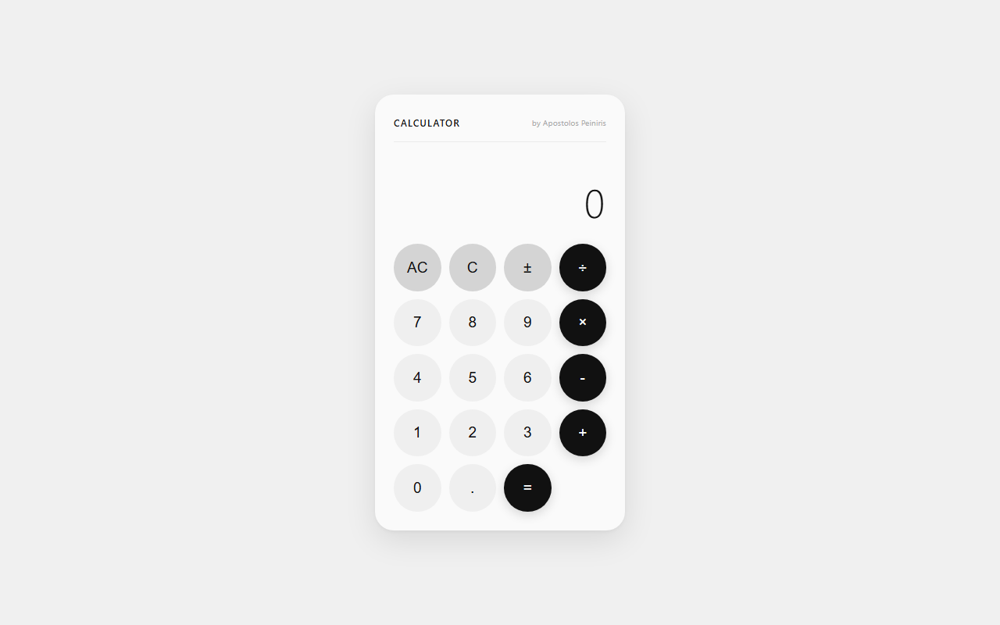

# Calculator

A four-function calculator in React. Built to practice state handling and component composition. No UI kit, no state library, no backend.

[Live demo](https://calculator-tpainn.vercel.app)



## Behavior

- Operations `+ - x /`, decimals (up to 3 places) and a sign toggle
- `AC` clears everything, `C` clears the current entry
- Input limits: 8 digits, one decimal point
- Division by zero and overflow show `ERR`, which only `AC` clears
- Keyboard input: digits and operators (`/` and `*` map to division and multiplication), `Backspace` deletes

## Structure

`src/App.jsx` holds the calculator state and logic. `src/Components` contains `Display`, `ButtonPad` and `Button`.

## Run

```bash
npm install
npm run dev
npm run build
```

React, Vite, plain CSS. Deployed on Vercel.