<div align="center">



<br>

[](https://calculator-tpainn.vercel.app)


</div>

<br>


A calculator that does exactly four things and does them cleanly. Built to learn React state and component composition: no UI kit, no state library, no backend.

## Features

- Four operations (`+ − × ÷`), decimals (up to 3 places), sign toggle `±`
- **AC / C** clear everything or just the current entry
- Guards against bad input: 8-digit cap, one decimal point, a clear `ERR` state (for example divide by zero) that only `AC` can leave
- **Keyboard input.** Type digits and operators (`/` and `*` map to `÷` and `×`), `Backspace` to delete
- Small component tree (`src/Components`: `Display`, `ButtonPad`, `Button`) with the calculator logic in one place
- Deploys as a static Vite build

## Run locally

```bash
npm install
npm run dev      # http://localhost:5173
npm run build    # production build in dist/
```

## Stack

React · Vite · plain CSS · deployed on Vercel

<div align="center"><sub>Built by <a href="https://github.com/TPAINN">Apostolos Peiniris</a></sub></div>